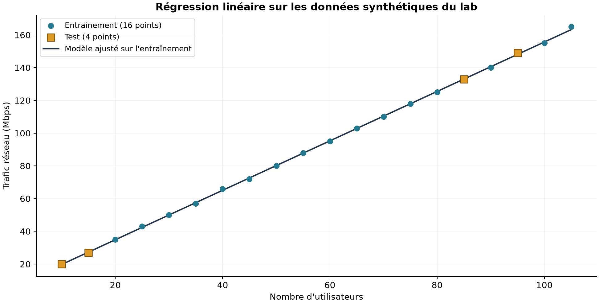
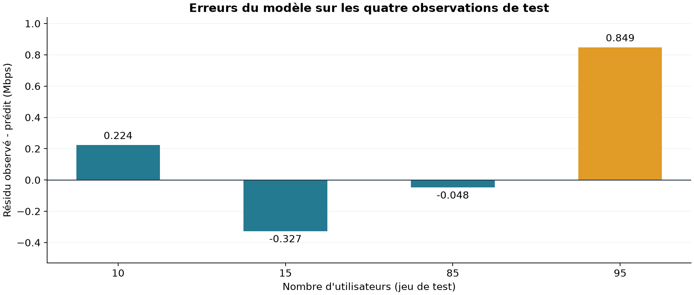

# Régression linéaire et analyse du trafic réseau

**Un laboratoire pédagogique pour estimer un trafic attendu, examiner les résidus et comprendre les limites d’un signal d’anomalie.**

Je suis Otmane Arajdal, étudiant en cinquième année de génie informatique, option cybersécurité. Dans ce projet, j’ai étudié une question simple : peut-on utiliser le nombre d’utilisateurs connectés pour construire une première référence du trafic réseau, puis repérer une observation qui s’en écarte ?

J’utilise une régression linéaire sur **20 observations synthétiques**. Le projet ne repose pas sur des captures réseau réelles et ne constitue pas un détecteur de cyberattaques validé. Il me permet surtout de relier les calculs du modèle à une interprétation de sécurité argumentée.

## Aperçu du travail

1. Définir l’entrée `utilisateurs` et la cible `trafic`, exprimée en Mbps.
2. Séparer les données en **16 observations d’entraînement et 4 de test**, avec `random_state=42`.
3. Entraîner un modèle `LinearRegression` et interpréter sa droite.
4. Calculer les prédictions, les métriques et les résidus du test.
5. Comparer plusieurs trafics simulés pour 110 utilisateurs à une référence commune.



## Résultats du modèle

L’équation apprise sur l’ensemble d’entraînement est :

```text
trafic prédit = 4,6729000151 + 1,5103001056 × utilisateurs
```

La pente correspond à environ **1,51 Mbps de trafic prédit supplémentaire par utilisateur** dans ce modèle. Elle ne décrit pas la consommation individuelle de chaque utilisateur. L’intercept est la prédiction mathématique à zéro utilisateur, en dehors des données disponibles ; je ne l’interprète pas comme une mesure de trafic de fond.

| Mesure sur le test | Valeur |
|---|---:|
| MAE | 0,362125 Mbps |
| MSE | 0,219965 (Mbps)² |
| R² | 0,9999369671 |
| Plus grand résidu absolu | 0,848590 Mbps, pour 95 utilisateurs |

Pour ce dernier point, le trafic observé est de **149 Mbps**, contre **148,151410 Mbps** prédits. Le résidu, défini par `observé − prédit`, vaut donc **+0,848590 Mbps**.

Ces faibles erreurs concernent seulement quatre points de test issus d’un jeu presque linéaire. Le R² n’est ni une précision de détection ni un taux de réussite face à des attaques. La séparation entraînement/test permet une évaluation hors apprentissage ; elle ne suffit pas à garantir la généralisation.



## Du résidu au signal d’investigation

Pour **110 utilisateurs**, le modèle prédit **170,805912 Mbps**. Le jeu s’arrête à 105 utilisateurs : prédire pour 110 constitue donc une légère extrapolation.

Le cas initial du lab utilise **220 Mbps simulés**, soit un résidu de **+49,194088 Mbps**. Il dépasse le seuil pédagogique de 40 Mbps. Les autres lignes ci-dessous sont des variations ajoutées pour observer le comportement de la même règle, avec le même modèle.

| Trafic simulé à 110 utilisateurs | Résidu (Mbps) | `abs(résidu) > 40` |
|---:|---:|---|
| 160 Mbps | −10,805912 | Non |
| 180 Mbps | +9,194088 | Non |
| **220 Mbps — cas initial** | **+49,194088** | **Oui** |
| 120 Mbps | −50,805912 | Oui |

La règle porte sur la valeur absolue : une baisse importante peut aussi déclencher le signal. Un écart exactement égal à 40 Mbps ne le déclenche pas, car la comparaison est stricte.

**Le seuil est arbitraire, sans calibration ni validation opérationnelle.** Une sauvegarde, une mise à jour ou une variation d’activité peut expliquer un écart. Avant de parler d’attaque, il faudrait consulter les journaux, les flux, les applications concernées, les authentifications et les événements planifiés. Ce projet ne mesure ni rappel d’attaques, ni précision de classification, ni taux de faux positifs.

## Exécuter le laboratoire

### Dans Google Colab

Ouvrir [Google Colab](https://colab.research.google.com/), choisir l’import d’un notebook et sélectionner [`notebooks/regression_trafic_reseau.ipynb`](notebooks/regression_trafic_reseau.ipynb). Exécuter les cellules dans l’ordre pour retrouver les données, les résultats et les graphiques.

### En local sous Windows

Depuis la racine du projet, créer un environnement Python puis installer les dépendances :

```powershell
python -m venv .venv
.venv/Scripts/python -m pip install -r requirements.txt
.venv/Scripts/python scripts/run_lab.py
```

Environnement vérifié : Python 3.12. Les versions des bibliothèques sont fixées dans `requirements.txt` et consignées dans `results/summary.json`.

L’utilisation directe du Python de l’environnement évite de dépendre de son activation dans PowerShell. Le script recalcule les résultats et produit les graphiques et fichiers de sortie. Les valeurs affichées dans le README sont arrondies ; les calculs conservent la précision du modèle.

## Organisation du dépôt

```text
ai-network-traffic-lab/
├── notebooks/regression_trafic_reseau.ipynb
├── data/trafic_synthetique.csv
├── scripts/run_lab.py
├── requirements.txt
├── assets/
│   ├── regression.png
│   └── residus.png
├── results/
│   ├── predictions-test.csv
│   ├── scenarios.csv
│   └── summary.json
├── docs/
│   ├── methodologie.md
│   ├── analyse-resultats.md
│   ├── sources-et-preuves.md
│   └── synthese-projet.pdf
└── GITHUB_SETUP.md
```

- [Méthodologie](docs/methodologie.md) : données, préparation, séparation et interprétation des paramètres.
- [Analyse des résultats](docs/analyse-resultats.md) : métriques, résidus, scénarios et limites.
- [Sources et preuves](docs/sources-et-preuves.md) : origine du travail et traçabilité des résultats.
- [Synthèse du projet](docs/synthese-projet.pdf) : présentation courte à lire ou à partager.
- [Préparation du dépôt GitHub](GITHUB_SETUP.md) : étapes de publication à réaliser avec son propre compte.

## Ce que je retiens

La régression linéaire fournit ici une référence facile à expliquer : elle relie un nombre d’utilisateurs à un débit attendu, puis le résidu rend l’écart visible. Sa simplicité est utile pour comprendre la démarche, mais les très bons résultats viennent aussi du caractère synthétique et presque linéaire des données.

Pour aller vers un cas réaliste, je commencerais par recueillir un historique daté, distinguer les types de flux et les périodes d’activité, puis utiliser une validation chronologique et calibrer le seuil. Ces pistes restent des prolongements : elles n’ont pas été expérimentées dans ce laboratoire.

Le notebook fourni est une **reconstruction exécutée et vérifiée à partir du support fourni**, distincte des captures historiques. Les graphiques et sorties du dépôt proviennent de cette exécution. Le support PDF intégral n’est pas redistribué. Deux captures de résultats sont conservées intactes dans `assets/evidence/`. Les variations de trafic et leur statut pédagogique sont documentés séparément.
