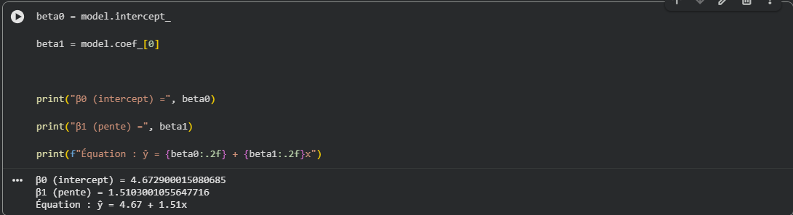
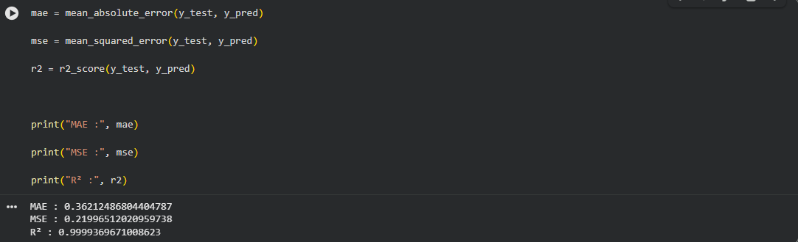

# Sources et traçabilité

## Support de départ

Le support fourni est un PDF de onze pages intitulé « TP Google Colab - Régression linéaire appliquée à la cybersécurité - Cas d’étude : prédiction du trafic réseau ». Il contient les étapes, les données synthétiques, des captures de cellules Colab et des réponses d’analyse. Les pages ci-dessous sont les positions physiques dans ce PDF. Aucun nom d’enseignant, établissement, date de session ou jeu de données de production n’est déduit du document.

Le dépôt porte le nom de lab. Il présente le travail d’Otmane Arajdal et une reconstruction exécutable du code, avec une mise en perspective des limites. Il ne revendique pas la création du support pédagogique ou d’un jeu de données réel.

## Ce qui vient du support

| Élément | Pages source | Fichier ou résultat correspondant |
|---|---|---|
| Objectif et distinction anomalie/attaque | 1 | README et analyse |
| Les vingt couples utilisateurs/trafic | 2 et 3 | `data/trafic_synthetique.csv` |
| Split 80/20, `random_state=42` | 4 et 5 | 16 entraînement, 4 test |
| Paramètres et équation | 5 | Capture intacte ci-dessous |
| Quatre prédictions et résidus | 6 et 7 | `results/predictions-test.csv` |
| MAE, MSE, R² | 7 | Capture intacte ci-dessous |
| Prédiction à 110 utilisateurs | 8 et 9 | 170,805912 Mbps |
| Observation simulée de 220 Mbps | 9 | Résidu de 49,194088 Mbps |
| Seuil arbitraire de 40 et avertissement | 9 et 10 | `abs(residu) > 40` |
| Questions et pistes d’interprétation | 10 et 11 | Discussion des limites |

### Paramètres visibles dans le support

### Métriques visibles dans le support

Ces deux images ont été extraites sans modification. Elles sont conservées comme preuves des résultats figurant dans le support. Le PDF intégral reste hors du dépôt ; les nouveaux graphiques ne sont pas présentés comme des captures historiques.

## Ce qui a été ajouté pour rendre le lab partageable

La reconstruction et sa vérification ont été réalisées le 20 octobre 2026. Le notebook original n’a pas été fourni : le fichier `.ipynb` du dépôt est recréé à partir des étapes et valeurs du support, puis exécuté. Le script, le CSV, les exports et les graphiques distinguent l’entraînement du test et permettent de recalculer les résultats.

Les variantes à 160, 180 et 120 Mbps et la comparaison à une moyenne d’entraînement sont des ajouts pédagogiques. Le cas 220 Mbps est le scénario source. Les variantes n’ajoutent aucun point à l’apprentissage. Elles restent des simulations, sans trafic capturé ni attaque exécutée.

Le texte extrait du PDF contient `plt.show(` incomplet ; la capture montre `plt.show()`. Le code exécutable utilise la syntaxe complète. La notation `trafic_mbps` explicite les unités de la colonne cible. Les coefficients gardent leur précision avant arrondi.

## Vérifications de la préparation

- Concordance des vingt couples entre le support, le CSV et le notebook autonome.
- Exécution complète du script et des cellules du notebook, sans erreur.
- Concordance numérique des coefficients, métriques, quatre prédictions et résidus avec les captures, à l’arrondi et à la précision flottante près.
- Comparaison des sorties du notebook et du script pour les quatre scénarios.
- Vérification des liens locaux et de la lisibilité des pages de la synthèse.

Les versions de la réexécution figurent dans [`summary.json`](../results/summary.json). Elles ne sont pas attribuées à la session Colab initiale, dont les versions ne sont pas visibles.

## Références techniques

- [scikit-learn - LinearRegression](https://scikit-learn.org/stable/modules/generated/sklearn.linear_model.LinearRegression.html)
- [scikit-learn - train_test_split](https://scikit-learn.org/stable/modules/generated/sklearn.model_selection.train_test_split.html)
- [scikit-learn - métriques de régression](https://scikit-learn.org/stable/modules/model_evaluation.html#regression-metrics)
- [scikit-learn - r2_score](https://scikit-learn.org/stable/modules/generated/sklearn.metrics.r2_score.html)

Le résultat constitue une reproduction sur des données synthétiques. Aucune performance de détection sur des incidents réels n’est mesurée.
